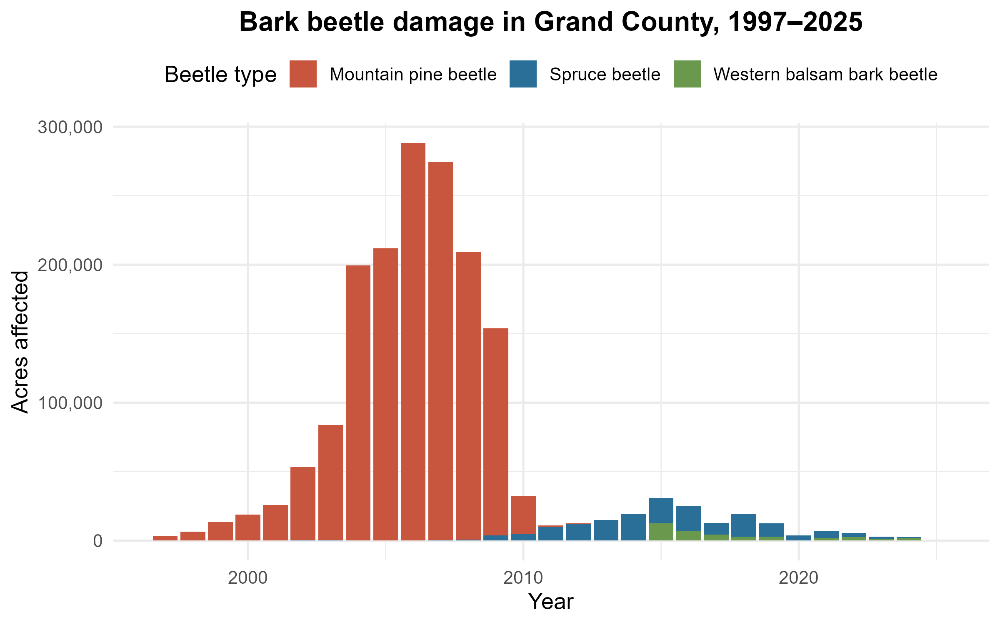

### Why this page

The Grand County project on the previous page was for NR 518 regarding wildfire risk. I kept getting pulled toward the beetles instead: their life cycles, and how they depend on the tree hosts they eventually kill. I ran my own project on how much beetle damage Grand County has endured over time. Everything on this page is separate from class work and my own work.

### The Question

How has bark beetle damage in Grand County changed over time? Which beetles were responsible, when did each one peak, and has there been any resurgence?

### The Data

I used the aerial detection surveys from the USDA Forest Service, Forest health Protection (Region 2). Each year, surveyors fly over the forest and map the area. I clipped the damage polygons to the Grand County boundary (TIGER) in QGIS, then summed the acres by years and beetle type in R. The beetles were narrowed to the most damaging: mountain pine beetle, spruce beetle, and western balsam bark beetle.

### Beetle Damage Across the Years

Bark beetle damage in Grand County came in waves. Mountain pine beetle damage grew from about 3,187 acres in 1997 to a peak of about 288,000 acres in 2006. Spruce beetle took over 2011 and affected about 15,000 to 19,000 acres a year from 2013 through 2016. By 2025, the mapped damage dropped to about 335 acres total.\
\


### What I found

::: {style="margin: 0.5rem 0 1.5rem; font-size: 0.9rem; text-align: right;"}
 *Change the time period with the toggle in the upper right-hand corner. Map created with R and the leaflet package.*
:::
```{r}
#| echo: false
#| message: false

library (tidyverse)
library (sf)
library (leaflet)

time <- st_read("data/beetles_clipped.gpkg", quiet = TRUE) |> 
st_transform (4326) |> 
  mutate (time_period = cut (SURVEY_YEAR, c(1996,2000,2005,2010,2015,2020,2025), 
  labels = c("1997-2000","2001-2005", "2006-2010", "2011-2015","2016-2020","2021-2025"))) |>   
  group_by (time_period) |> 
  summarize()

county <- st_read("data/grand_county.gpkg", quiet = TRUE) |>
  st_transform(4326)

color_palette <- colorFactor(c("#FFE08A", "#F6C85F", "#EE9B3F", "#D1495B", "#8E2C57", "#4B2142"), time$time_period)

leaflet(time) |> 
  addProviderTiles("Esri.NatGeoWorldMap") |> 
  addPolygons(fillColor = ~color_palette(time_period), fillOpacity = .9,color = "black", weight = 0.4, opacity = 1,group = ~time_period) |>
  addPolygons( data = county, fill = FALSE,color = "black", weight = 2) |>  
  addLayersControl(overlayGroups = levels(time$time_period)) |> 
  addLegend(pal = color_palette, values = ~time_period, title = "Years surveyed", opacity = 1)
```

::: {style="margin-top: 1.5rem;"}
Damage came in waves. It started small in 1997 with about 3,200 acres, and the mountain pine beetle spread, peaking in 2006 at about 288,000 acres in a single year. From 2011 onward, the spruce beetle took over, but at a smaller scale: about 15,000 to 19,000 acres a year from 2013 to 2016. Spruce beetle had one rebound in 2018, at about 16,600 acres, but mostly declined. Current data would suggest there are low levels of major beetles, with the exception of the western balsam bark beetle which has shown fairly consistent damage.
:::
### Limits

Aerial surveys map damage by eye from the air, so they can show patterns, but are not exact.

Survey conditions can change year to year, so changes may reflect on the survey, not the beetles.

### Tools and data

**Tools:** QGIS and R\
**County boundary:** U.S. Census Bureau, TIGER 2023\
**Basemap:** Esri\
**Beetle data:** USDA Forest Service (2025). Forest Health Protection and its partners. Insect and Disease Detection Survey (IDS), CONUS Region 2, all years \[Data set\]. Retrieved September 8, 2026, from <https://www.fs.usda.gov/science-technology/data-tools-products/fhp-mapping-reporting/detection-surveys>
