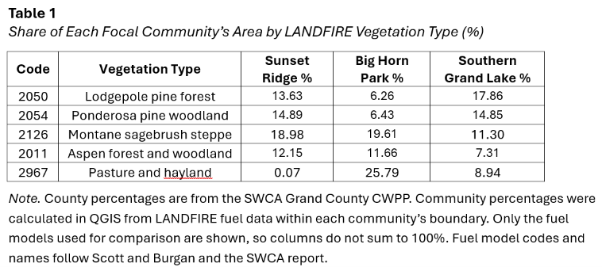

Map by Nayeli, originally made for NR 518: Climate Impacts and Risk Assessments group project and refined here. Colorado State University, Fall 2026.

### The Question

Where are residential communities in Grand County exposed to wildfire fuels in beetle-killed forest, and which communities should a vulnerability assessment focus on?

### Study Area

Grand County covers 1,846 square miles and has about 16,500 residents. About 70% of the land is federally owned. The county's wildfire protection plan (CWPP) maps 30 communities. I narrowed these to three that sit in different parts of the county, so their hazards differ: Big Horn Park, Southern Grand Lake, and Sunset Ridge.

### What I Found

{width="543"}

Lodgepole pine covers 17.9% of Southern Grand Lake, 13.6% of Sunset Ridge, and 6.3% of Big Horn Park, using LANDFIRE vegetation data (Table 1). The largest vegetation type differs in each community: lodgepole pine in Southern Grand Lake (17.86%), sagebrush steppe in Sunset Ridge (18.98%), and pasture and hayland in Big Horn Park (25.8%). Big Horn Park also has the least forest of the three, with ponderosa pine at 6.43% and lodgepole pine at 6.26%.

### Tools and data

Map by Nayeli, 2026, revised from my NR 518 coursework.

**Tools:** QGIS and R\
**Data sources:** LANDFIRE 2026; U.S. Census Bureau, TIGER 2023; Grand County CWPP (SWCA, 2023)\
**Beetle data:** USDA Forest Service (2025). Forest Health Protection and its partners. Insect and Disease Detection Survey (IDS), CONUS Region 2, all years \[Data set\]. Retrieved September 8, 2026, from <https://www.fs.usda.gov/science-technology/data-tools-products/fhp-mapping-reporting/detection-surveys>
