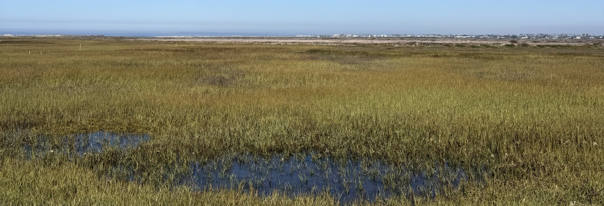

::: {style="text-align: center; margin-top: -7rem;"}
# Nayeli Lee [<i class="bi bi-linkedin"></i>](https://www.linkedin.com/in/nayelilee)
:::

### Bio

I'm an entry level environmental and sustainability professional with field and lab experience in data collection, GIS mapping, and vegetation monitoring. I've contributed data to a peer-reviewed publication on invasive species detection.

I'm completing my Professional Science Master's in Ecosystem Science and Sustainability at Colorado State University, working toward a career in sustainability, with the end goal of Carbon or ESG analyst. I'm interested in water and carbon, with special focus in habitat restoration and wetlands.

Outside of coursework, I volunteer with the Watershed Enhancement Team, led by our tireless leader, Tiffany Swiderski. The team's work includes invasive species removal, fire mitigation, and watershed clean-ups.

### Publication

::: apa
Middleton, E. G., & Lee, N. (2026). Detecting *Thrips parvispinus* (Thysanoptera: Thripidae) in retail plant stores in Southern California. *Journal of Insect Science*, *26*(5), Article ieag105. <https://doi.org/10.1093/jisesa/ieag105>
:::
